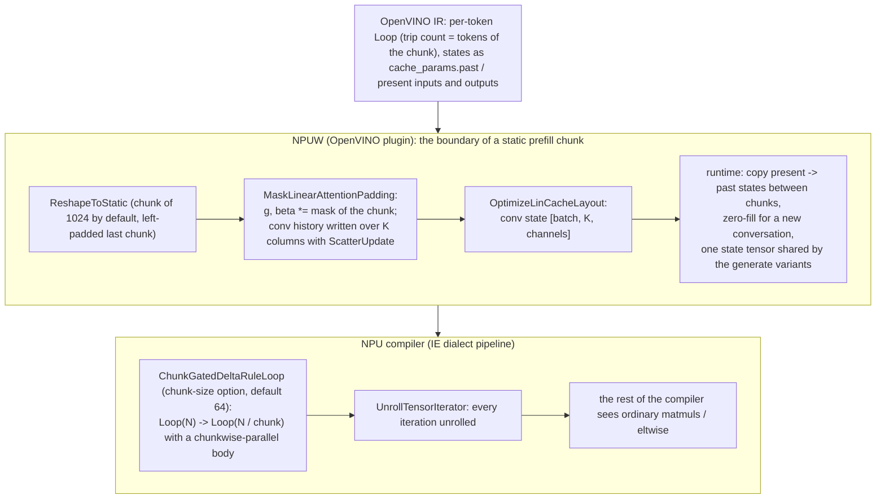

# Gated DeltaNet on the NPU: what NPUW and the NPU compiler do, and how it compares with this package

Read from source (OpenVINO `src/plugins/intel_npu/src/plugin/npuw` at 8e3db2a6b5, the NPU compiler `src/vpux_compiler` at 0667892172). Nothing here was run through OpenVINO GenAI: the
numbers below are from the numpy interpreter of this repository; the measurements on a device go to the local notes (`docs/npu-local`).

## 1. Where the loop goes

The OpenVINO IR of a Qwen3.5 / Qwen3-Next style model keeps the recurrence as a per-token `Loop` (body: `exp(g) * h`, `ReduceSum(h * k)`, the delta, an outer product, `ReduceSum(h * q)`,
`ScatterUpdate` into the output). NPUW does **not** rewrite the loop. The work is split in two layers:



* NPUW: [mask_linear_attention_padding.cpp](../../../openvino/src/plugins/intel_npu/src/plugin/npuw/npuw_transformations/mask_linear_attention_padding.cpp),
  [optimize_lincache_layout.hpp](../../../openvino/src/plugins/intel_npu/src/plugin/npuw/npuw_transformations/optimize_lincache_layout.hpp), `llm_infer_request.cpp` (`copy_lincache`,
  `share_lincache_across_generate_variants`).
* Compiler: `src/dialect/IE/transforms/passes/chunk_gated_delta_rule_loop.cpp` (1979 lines), registered in `IE/transforms/pipelines.cpp` right before `UnrollTensorIterator`.

A WebNN graph never reaches that pass: WebNN has no loop, so the equivalent of both layers is done by this package (host loop over prefill chunks, chunkwise body written out with operators,
padding handled in the graph).

### The pass, its conditions

* matches the `IE::Loop` body: `exp(gate) * h`, `ReduceSum(h * k)`, `v - <h,k>`, `* beta`, outer product, `Add`, `ReduceSum(h_new * q)`, `ScatterUpdate(accum, iter, y)`;
* trip count fixed and equal to the sequence length, **divisible by the chunk size** (a decode loop with one iteration is not chunked, only unrolled), constant true exit condition,
  outputs must be invariant outputs, scatter indices derived from the iteration index; the gate has to be negative at the loop boundary (`isGateNegatedBeforeExp`: a positive log-decay makes
  `exp(cumsum)` overflow);
* a second pattern (`h_t = g_t h_{t-1} + u_t`, Mamba style) is only unrolled `chunk` steps per iteration, no mathematical change.

### What a chunk body computes (chunk = L, default 64; all heads at once)

```
cum        = CumSum(g)                 cum_excl = exclusive CumSum(g)
D          = exp(cum_i - cum_j) * tril                                   (exp first, mask after)
L          = -(k kbeta^T) * exp(cum_excl_i - cum_j) * strict_tril
P          = (I - L)^-1  by doubling:  P = I;  repeat log2(L) times:  P = P + Lp P;  Lp = Lp Lp          (6 rounds for 64)
rhs        = v - exp(cum_excl) * (k h)                  <- depends on the state
w          = P rhs;   c = beta w
out        = ((q k^T) * D) c + (q * exp(cum)) h
h_new      = exp(cum_last) h + (k * exp(cum_last - cum))^T c
```

and `Loop(N / L)` carries `h`. For a prefill chunk of 128 tokens that is 2 unrolled bodies; of 1024 tokens, 16.

## 2. Comparison with `gated_delta_batched` (this package)

| | NPU compiler pass | this package |
|---|---|---|
| tokens per dependent step | 64 (default) | 16 (sub-chunk) |
| dependent steps for 128 tokens | 2 (each with ~6 dependent matmuls: `k h`, `P rhs`, `o_intra`, state update ...) | 8 (each 3 matmuls + elementwise) |
| triangular solve | Neumann doubling on 64 x 64, 11 matmuls per head | row substitution on 16 x 16, 16 steps, **for all 256 head x sub-chunk batches at once** |
| where the solve sits | after the state (`rhs` needs `h`): nothing can be hoisted | before the state: `value`, `k_cumdecay` do not depend on it, computed for all sub-chunks as a batch |
| decay matrices | `exp` of the difference, then masked | masked, then `exp` (no `inf * 0` in float16) |
| cumulative gate | `CumSum` operator | matmul with a triangular constant |
| padding | `g`, `beta` * mask; conv history by `ScatterUpdate` of K columns | `g`, `beta` * mask; conv history by a permutation matmul (`conv_perm`) |

Two things in the compiler's form are worth knowing (numbers from `tools/gdn_segments.py` graphs run through the numpy interpreter, 32 heads x 128 tokens, error relative to the float64 token loop):

| form | typical decays | "fast" decays | nearly parallel keys (`mixed-corr`) |
|---|---|---|---|
| sub-chunk 16, substitution (package) | f32 2e-7, f16 9e-4 | f16 1.6e-3 | f16 1.7e-3 |
| compiler form, chunk 64, doubling | f32 3e-7, f16 1.2e-3 | f16 7.9e-3 | **f32 5e17, f16 NaN** |
| compiler form, chunk 32, doubling | f32 3e-7, f16 9e-4 | f16 3.5e-3 | **f32 13, f16 NaN** |

* The plain doubling `(I + L)(I + L^2)(I + L^4)...` explodes when the keys are nearly parallel: the powers of `L` grow like binomial coefficients before they cancel
  (`unit_lower_inverse_blocked` documents the same thing). It is exact, but only in exact arithmetic: in the interpreter even float32 fails on this data at chunk 64 and float16 gives NaN.
  That is why the package keeps blocks of 16 and a substitution.
* The compiler's row index uses the **exclusive** cumulative gate: the delta of token t is computed from `h_{t-1}` *not yet decayed* by `g_t`. HF Qwen3.5 (`torch_recurrent_gated_delta_rule`) decays
  first (`last_state * g.exp()`, then `kv_mem`). The two recurrences differ by ~1 % on typical data and ~5 % on fast decays (the `npuw-excl` graph vs the HF reference in the interpreter).
  Whether the IR's loop body (which the pass matches) is written with the decayed or the undecayed state was not checked here; the package follows HF.

## 3. What was taken from it

* The padding handling was already the same idea; the pass confirms that `g`, `beta` * mask is the right way (identity step) and that the conv history must be written in front of the
  first real token, not in front of the padding.
* Not adopted: chunk 64 / doubling (not usable on parallel keys), solve after the state (blocks hoisting).
* Candidates that remain (small): conv history by a scatter of 3 rows instead of the `[S+3, S+3]` permutation matmul; `cumulativeSum` instead of the triangular matmul.

## 4. Measuring the compiler's form on the device

`python tools/gdn_segments.py --export ../bench/data/gdn_seg` writes `whole`, `whole_npuw64`, `whole_npuw32` (and the other cores) for `bench/raw/gdn.html`:

```
gdn.html?dir=../data/gdn_seg/&data=mixed&chain=20&only=whole
gdn.html?dir=../data/gdn_seg/&data=mixed-corr&chain=20&only=whole
```

`mixed-corr` is the adversarial regime; its expected output is the accurate core, so the error column of the `npuw` graphs shows the explosion directly.
