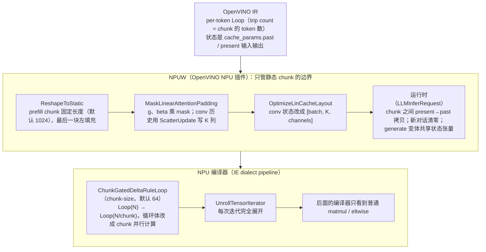
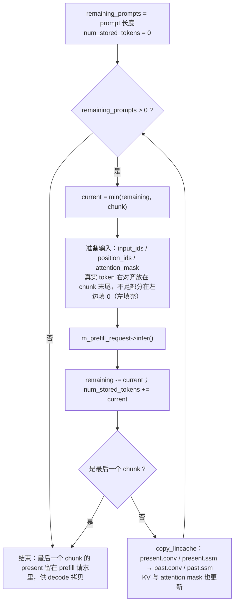
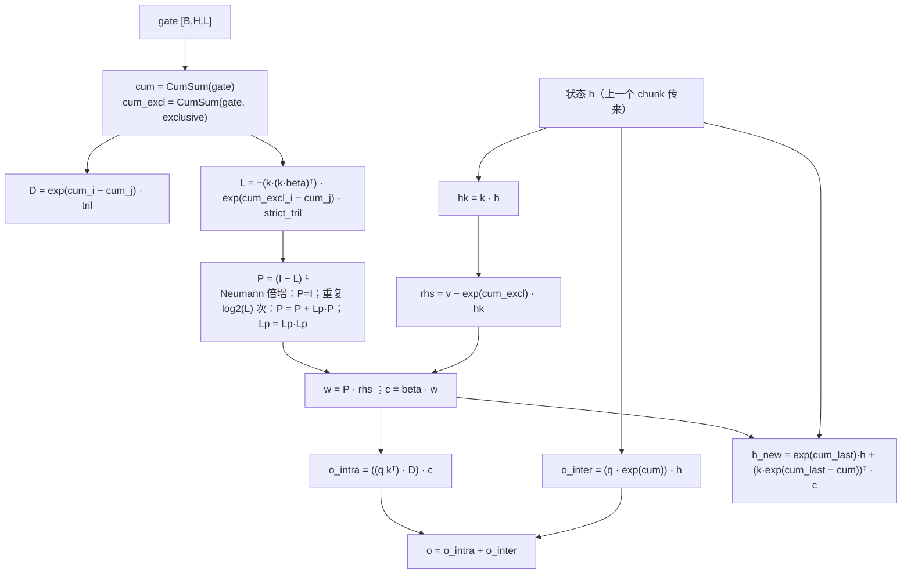
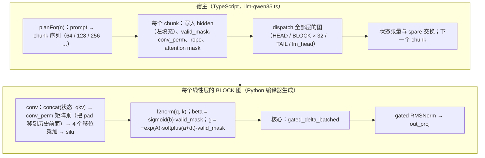

# Qwen3.5 线性注意力在 NPU 上的实现：NPUW 与 NPU 编译器怎么处理 Loop，和本项目的对比

> 英文简版见 [qwen35-npuw.md](qwen35-npuw.md)。本文是中文详细版，重点解释：
> 1. OpenVINO IR 里的逐 token `Loop` 长什么样；
> 2. NPUW 的 chunk prefill 循环、padding 处理、状态搬运；
> 3. NPU 编译器的 `ChunkGatedDeltaRuleLoop` pass 如何把 `Loop(N)` 改写成 chunk 并行形式；
> 4. 本项目（WebNN 没有 Loop）的做法与它们的逐项对比。
>
> 依据：直接阅读源码——OpenVINO `src/plugins/intel_npu/src/plugin/npuw`（提交 8e3db2a6b5）、NPU 编译器 `src/vpux_compiler`（提交 0667892172）。
> 没有用 OpenVINO GenAI 实际跑过 Qwen3.5：文中的数字都是本仓库 numpy 解释器的结果；设备上的实测放在本地笔记（`docs/npu-local`，不入库）。

---

## 1. 问题：线性注意力是一个必须按顺序更新的状态

Qwen3.5 每 4 层里有 3 层是 Gated DeltaNet（线性注意力），每层每个 head 带一个状态 `S ∈ R^{dk×dv}`（这里 `dk = dv = 128`，32 个 value head）。逐 token 的递推（HF 的 `torch_recurrent_gated_delta_rule`）是：

```
S   ← S · exp(g_t)                          # 衰减（g_t < 0）
kv  ← kᵀ_t S                                # 状态对当前 key 的"预测"
Δ   ← (v_t − kv) · β_t                      # delta rule：只写状态预测不了的部分
S   ← S + k_t ⊗ Δ                           # 外积写入
y_t ← qᵀ_t S                                # 读出
```

要点：**第 t 步依赖第 t−1 步的 `S`**。静态图里没法用循环表达"处理 N 个 token"，所以需要一个办法：

* OpenVINO：把循环留在 IR 里（`Loop`），由 NPU 编译器在编译期处理；
* WebNN（本项目）：图里没有循环，只能由宿主在 chunk 之间循环 + 图内部把一个 chunk 写成 chunkwise 并行形式。

两条路的数学基础相同：**这个递推对状态是线性（仿射）的**，所以可以把连续一段 token 合并成一次状态更新，段内的工作可以并行。

---

## 2. OpenVINO IR 里的 Loop

Qwen3.5 / Qwen3-Next 的 OV IR（optimum-intel 导出）里，线性注意力的递推是一个 `v5::Loop`，trip count = 本次输入的 token 数：

| Loop 的输入 | 含义 |
|---|---|
| 按序列轴切片（axis=2，每次 1 个 token）| `q`, `k`, `v`，以及逐 token 标量 `g`、`beta`（形状 `[B,H,L]`）|
| 合并（feedback）输入 | 状态 `h [B,H,dk,dv]`，以及输出累加器 `[B,H,N,dv]` |

Loop 体（每次迭代）：`exp(g)` → Unsqueeze → `Multiply(h, ·)`（衰减）；`ReduceSum(h·k)` 得 `⟨h,k⟩`；`v − ⟨h,k⟩`；`× beta`；`k ⊗ Δ`（用 Multiply 广播实现外积）；`Add`；`ReduceSum(h_new·q)` 得 `y_t`；`ScatterUpdate(accum, iter, y_t)` 把 `y_t` 写到累加器第 `iter` 行。

它是"逐 token、逐元素 + ReduceSum"的写法，不用 matmul。如果原样交给 NPU，需要 N 次迭代，每次都是一串很小的算子。

---

## 3. 整体分工：loop 留在图里，两层处理

NPUW 不改写这个 loop。分工如下：



源码位置：

* NPUW：[mask_linear_attention_padding.cpp](../../../openvino/src/plugins/intel_npu/src/plugin/npuw/npuw_transformations/mask_linear_attention_padding.cpp)、
  [optimize_lincache_layout.hpp](../../../openvino/src/plugins/intel_npu/src/plugin/npuw/npuw_transformations/optimize_lincache_layout.hpp)、
  [llm_infer_request.cpp](../../../openvino/src/plugins/intel_npu/src/plugin/npuw/llm_infer_request.cpp)（`infer_chunked_prefill`、`copy_lincache`、`share_lincache_across_generate_variants`）、
  [llm_compiled_model.cpp](../../../openvino/src/plugins/intel_npu/src/plugin/npuw/llm_compiled_model.cpp)（第 1113 行调用 `OptimizeLinCacheLayout`，第 1186 行调用 `MaskLinearAttentionPadding`）。
* 编译器：[chunk_gated_delta_rule_loop.cpp](../../../npu_compiler/src/vpux_compiler/src/dialect/IE/transforms/passes/chunk_gated_delta_rule_loop.cpp)（1979 行），在
  [pipelines.cpp](../../../npu_compiler/src/vpux_compiler/src/dialect/IE/transforms/pipelines.cpp) 里紧挨着 `UnrollTensorIterator` 之前注册。

**对 WebNN 路径意味着什么**：WebNN 图里没有 `Loop` 这个算子，所以这个编译器 pass 永远不会触发。送进 NPU 编译器的是已经展开好的普通算子图。上图中"边界处理"和"chunk 并行"两件事，都得由本项目自己完成。

---

## 4. NPUW 的 chunk prefill 循环

### 4.1 宿主侧循环（`infer_chunked_prefill`）

NPUW 把 prompt 切成固定大小的 chunk（`NPUW_LLM_PREFILL_CHUNK_SIZE`，默认 1024），**同一个静态 prefill 图**反复调用：



要点：

* **只有最后一个 chunk 可能不满**，它被"左填充"（真实 token 在右，pad 在左）。`attention_mask` 里 pad 位置为 0。
* **线性注意力状态不是 KV cache，不增长**，每个 chunk 结束后用 `copy_lincache` 整块拷贝（`present → past`，按名字 `cache_params.past.{conv|ssm}.N` 匹配）；最后一个 chunk 不在这里拷贝，进入 decode 时由 `copy_lincache(prefill 请求 → generate 请求)` 一次性拷贝。
* 新对话开始时，`zero_prefill_past_tensors` 把所有 past 线性状态清零；多个 generate 变体（不同 KV 长度）共用同一份状态张量（`share_lincache_across_generate_variants`），因为状态大小与 KV 长度无关。

本项目的宿主循环（[llm-qwen35.ts](../../src/runtime/llm-qwen35.ts) 的 `prefill`）与之同构：`planFor(n)` 把 prompt 切成 chunk 序列，每个 chunk 左填充，状态张量成对（当前 + spare）、dispatch 后交换，开始新 prompt 时清零。区别只在于：状态搬运用"spare 交换"而不是拷贝。

### 4.2 为什么左填充会污染线性状态

KV cache 的注意力靠 mask 把 pad 位置挡住，没问题。但线性注意力的状态是**被所有位置累积**的，mask 不够用。`mask_linear_attention_padding.hpp` 里写了两处污染：

1. **卷积（因果 depthwise conv，kernel K=4）**：图里是 `Concat(past_conv [B,C,K], x [B,C,L])`。左填充时，pad 位置夹在"上一个 chunk 的历史"和"第一个真实 token"之间，真实 token 的卷积窗口看到的是 0，而不是历史；同时新的 conv 状态（Concat 的最后 K 列）也取错了列。
2. **递推（ssm）**：pad 位置同样会衰减状态（`g = −exp(A)·softplus(dt_bias) ≠ 0`）并写入状态（`beta = sigmoid(0) = 0.5`；卷积窗口与历史重叠时 `k`、`v` 也可能非零）。

### 4.3 `MaskLinearAttentionPadding`：两处修补

整个 pass 是**要么全做要么不做**（任何一个 conv / ssm 状态没匹配上，就保持原模型不变并告警）。

**(a) 递推：让 pad 位置成为恒等步。** 把进入 `Loop` 的逐 token `g`、`beta` 都乘上本 chunk 的 mask。这样 pad 位置 `g=0, beta=0`，即 `S ← S·exp(0) + 0 = S`，状态原样通过。它通过 Loop 体结构识别 `g` 与 `beta`：`g` 的消费链是 `[Convert]→Exp→Unsqueeze→Multiply(状态, ·)`；`beta` 的消费链是 `[Convert]→Multiply(delta,·)→Unsqueeze→Multiply(key,·)→Add(衰减后状态, ·)`。

**(b) 卷积：把历史写到第一个真实 token 的前面。** `pad = L − sum(attention_mask[:, -L:])` 在图里计算，然后对 Concat 的结果做一次 `ScatterUpdate`，把历史 `[B,C,K]` 写进列 `pad + [0, K)`。例（K=4, L=4, pad=2）：

```
Concat 后：    [h0 h1 h2 h3 | 0  0  x2 x3]
ScatterUpdate：[h0 h1 h0 h1 h2 h3 x2 x3]      # 列 2..5 被历史覆盖，真实 token x2 的卷积窗口 = [h1 h2 h3 x2]
```

最前面 `pad` 列保持原样：它们只影响 pad 位置自己的卷积输出，而 pad 位置在递推里是恒等步，其他地方也被 mask 掉。只写 K 列，不需要再算一份与 Concat 一样大的张量。满 chunk（pad=0）时是恒等。

**(c) `OptimizeLinCacheLayout`**：conv 状态从 `[B,C,K]` 改成 `[B,K,C]`（channels 在最内层）。状态只在 NPUW 自己的"present→past"之间流动，物理布局可以自由选择；channels 在最内层时，编译器可以直接用 NHWC 喂给 `Concat→GroupConvolution`，省掉每个 token 的 transpose（慢的逐元素 permute DMA）及其逆。

---

## 5. NPU 编译器：`ChunkGatedDeltaRuleLoop`

### 5.1 数学基础：为什么 chunk 可以并行

逐 token 递推对状态是仿射的：`h_t = M_t h_{t−1} + u_t`，其中 `M_t = exp(g_t)(I − β_t k_t k_tᵀ)`。把相邻 L 个 token 合并，得到一次"chunk 级"的仿射变换，**chunk 内部的所有量只依赖 q、k、v、g、beta，不依赖进入 chunk 时的状态**；状态只在 chunk 之间串行传递。

Delta rule 的 chunk 内部有一个三角方程组：第 i 个 token 写入状态的量依赖前面所有 token 写入的量。这就是 HF `torch_chunk_gated_delta_rule` 里那个 `for` 循环（逐行前代）要解的东西，数学上是 `(I − L)⁻¹`，`L` 是严格下三角矩阵。

### 5.2 pass 的匹配条件

`matchGDRPattern` 匹配 `IE::LoopOp` 的体：`exp(gate)·h` → `ReduceSum(h·k)` → `v − ⟨h,k⟩` → `×beta` → 外积 → `Add` → `ReduceSum(h_new·q)` → `ScatterUpdate(accum, iter, y)`。并要求：

* trip count 固定且等于序列长度，**能被 chunk size 整除**（否则 `"Seq length not divisible by chunk size, skipping"`，保持原 Loop）；
* 退出条件恒为 true；输出只能是 invariant 输出（不能有 concat 输出）；ScatterUpdate 的索引必须来自迭代变量；
* **gate 在进入 Loop 时必须已经是负数**（`isGateNegatedBeforeExp`）。如果体内才取负，说明进入的是正数，`CumSum` 会无限增长，`exp(cumGate)` 会溢出，这时不做 chunk 化。

不满足就原样保留，随后 `UnrollTensorIterator` 把原 Loop 逐 token 展开（decode 时 N=1，就是展开一次）。

另外有一个**第二种模式**（`matchSimplifiedGDRPattern`）：`h_t = gate_t·h_{t−1} + u_t`（Mamba 风格）。它没有数学变换，只是把 `Loop(N)` 改成 `Loop(N/L)`，每次迭代顺序展开 `L` 个时间步。

### 5.3 改写后的结构

```
Loop(N)     输入：k q v gate beta（按 axis=2 每次切 1 个 token）
                  状态 h，输出累加器
   ↓
reshape：[B,H,N,D] → [B,H,C,L,D]，C = N/L        （gate、beta：[B,H,N] → [B,H,C,L]）
Loop(C)     每次迭代取一个 chunk [B,H,1,L,D]，反馈输入只有 h；
            输出用 concat_output（[B,H,1,L,dv] 沿 axis=2 拼接），不再用 ScatterUpdate 复制整个累加器
   ↓
reshape 回 [B,H,N,dv]
```

输出累加器用 concat 取代 `ScatterUpdate`：原来每次迭代都要复制整块 4 MB 的累加器，现在每次只产生本 chunk 的一段。然后整个 `Loop(C)` 被 `UnrollTensorIterator` 展开：128 token 的 prefill chunk 在 chunk=64 时展开 2 个体；NPUW 默认 1024 的 chunk 则是 16 个体。

### 5.4 chunk 体里算什么（L = chunk，所有 head 一起，`buildChunkedGDR`）



一些细节：

* **求逆用 Neumann 倍增**：对严格下三角的 `L`，`(I−L)⁻¹ = I + L + L² + … + L^{L−1}` 恰好是有限项（`L^L = 0`）。倍增 `P ← P + Lp·P; Lp ← Lp·Lp` 只需 `log2(L)` 轮（L=64 是 6 轮，约 11 个 64×64 matmul / head）。代码注释里它们也承认"每行逐个前代没法表达"，所以选了这个。
* **求解放在状态之后**：`rhs = v − exp(cum_excl)·(k·h)` 依赖 `h`，所以 `P·rhs` 必须等上一个 chunk 的状态。一个 chunk 的依赖链上约有 6 个串联的 matmul：`k·h → P·rhs → o_intra`，`state_update` 等。
* **行索引用"排他"累加 gate**（`cum_excl`）：第 t 个 token 的 delta 用的是**尚未被 `g_t` 衰减**的上一状态。

---

## 6. 本项目怎么做

### 6.1 总体结构



核心 `gated_delta_batched`（128 token = 8 个子块 × 16 token，32 个 head）：

* **阶段 1：与状态无关，对"head × 子块 = 256 个 batch"一次做完**：累加 gate（下三角常数 matmul）、衰减矩阵、`A = (β k)kᵀ · D`（严格下三角）、**三角方程 `(I + A)⁻¹ [βv | βk·exp(gc)]`**（16 步逐行前代，对 256 个 batch 同时）、`q kᵀ · D`、衰减后的 key。
* **阶段 2：只剩状态在 8 个子块之间依赖**：`v_new = value − k_cumdecay·S`；`out = q_gate·S + attn·v_new`；`S ← S·total + k_decayed·v_new`。

### 6.2 与 NPU 编译器 pass 的对比

| 项目 | NPU 编译器 pass | 本项目 |
|---|---|---|
| 每个依赖步的 token 数 | 64（默认） | 16（子块）|
| 128 token 的依赖步数 | 2（每步约 6 个串联 matmul） | 8（每步 3 个 matmul + elementwise）|
| 三角求解 | Neumann 倍增，64×64，约 11 个 matmul / head | 逐行前代，16×16，16 步；**对 256 个 head×子块 batch 同时做** |
| 求解位置 | 在状态之后（`rhs` 依赖 `h`），无法提前 | 在状态之前（`value`、`k_cumdecay` 不依赖状态），批量预先算好 |
| 衰减矩阵 | 先 `exp(差)` 再乘下三角 mask | 先乘 mask 再 `exp`（f16 下不会 `inf×0=NaN`）|
| 累加 gate | `CumSum` 算子 | 下三角常数 matmul |
| delta 的状态 | 排他累加：用未被 `g_t` 衰减的状态（见 6.3）| 包含 `g_t`：与 HF 一致（先衰减再取 `kv`）|
| padding：递推 | `g`、`beta` 乘 mask | `g`、`beta` 乘 `valid_mask`（同样的思路）|
| padding：卷积 | `ScatterUpdate` 写 K 列历史 | `conv_perm` 置换矩阵乘 `[S+3,S+3]×[S+3,C]` |
| 状态搬运 | 宿主拷贝 present→past | spare 张量交换，不拷贝 |
| 状态 conv 布局 | `[B,K,C]`（OptimizeLinCacheLayout）| `[1,3,C]`（本来就是 channels 最内层）|
| decode（N=1）| Loop 一次迭代展开 | 单步更新图 `gated_delta_step` |

### 6.3 两处差异的影响（numpy 解释器的数据，32 head × 128 token，对比 float64 逐 token 参考）

我把编译器 pass 的公式用 WebNN 算子照搬成了图（`gated_delta_npu_compiler`，`tools/gdn_segments.py` 里是 `whole_npuw64` / `whole_npuw32`），在解释器里与我们的形式对比：

| 形式 | 普通衰减 | 快衰减 | 相近 key（重复文本，`mixed-corr`）|
|---|---|---|---|
| 子块 16 + 逐行前代（本项目）| f32 2e-7，f16 9e-4 | f16 1.6e-3 | f16 1.7e-3 |
| 编译器形式，chunk 64，倍增 | f32 3e-7，f16 1.2e-3 | f16 7.9e-3 | **f32 误差 5e17，f16 NaN** |
| 编译器形式，chunk 32，倍增 | f32 3e-7，f16 9e-4 | f16 3.5e-3 | **f32 误差 13，f16 NaN** |

1. **倍增求逆在 key 相近时会爆。** `(I+L)(I+L²)(I+L⁴)…` 在精确算术下是精确的，但 `L` 的幂在相消之前按二项式系数增长。key 近似平行（重复文本、`beta` 接近 1）时，64×64 的矩阵幂数值上直接溢出——解释器里连 float32 都失败。这就是本项目把块限制在 16 并用逐行前代的原因（`unit_lower_inverse_blocked` 的 docstring 里有同样的说明）。编译器 pass 在真实数据上是否遇到，我没有数据；它只在 `isGateNegatedBeforeExp` 上做了一道溢出检查，没有对这个问题做防护。
2. **"排他"与 HF 是两个不同的递推。** HF 的 `torch_recurrent_gated_delta_rule` 先 `last_state *= g.exp()`，再算 `kv_mem`；编译器公式里 `rhs` 用的是 `exp(cum_excl)`，对应的是"用上一状态（未衰减）算 delta"。两者在普通数据上差约 1%，快衰减上差约 5%（解释器：`npuw-excl` 图对 HF 参考）。Loop 体里到底是哪一种取决于 IR 怎么写的，这一点我没有核实；本项目跟 HF 走。
3. **掩码顺序**：编译器是 `exp` 之后再乘下三角；上三角的差值是正数，`exp` 之后在 f16 里是 `inf`，`inf×0=NaN`。我们先乘 mask 再 `exp`。

4. **设备上的结果与解释器不一致。** 在 NPU 上，chunk 64 / 32 的倍增形式即使在普通数据上也不可用（相对误差几十个百分点），而解释器的 f16 模拟只有 1e-3 量级；相近 key 的数据上两者都彻底爆掉。块对角求解（8×8 块的 Neumann 乘积加 `M⁻¹ − M⁻¹ Al M⁻¹`）同样：普通数据上比逐行前代差一个数量级，相近 key 上爆掉，在真实模型里把第 0 层就弄错了。结论：**乘积形式的求逆（一串 matmul 的连乘）在 NPU 的 f16 下不能指望解释器的数字，只有逐行前代的数值和解释器一致。** 速度上它们确实快（核心约 2 ms，对 4 ms），代价是正确性。具体设备数据不放在入库文档里。

---

## 7. 借鉴与未采用

* **已经一致的**：padding 用"`g`、`beta` 乘 mask 变成恒等步"；conv 历史必须放在第一个真实 token 之前，不能放在 pad 之前；conv 状态 channels 在最内层；chunk 之间状态原样传递。
* **没采用**：chunk 64 + 倍增（key 相近时不可用）；求解放在状态之后（阻止提前并行）。
* **还可以试（收益小）**：
  * 卷积历史改成"只写 3 行"的 scatter，代替 `[S+3,S+3]` 置换 matmul（之前估计省约 2.5%）；
  * 用 WebNN 的 `cumulativeSum` 代替累加 gate 的下三角 matmul。
* **和线性注意力无关的 NPUW 优化**（金字塔注意力、host flash attention、prefix cache）这里不展开。

---

## 8. 在设备上测编译器形式

```
python tools/gdn_segments.py --export ../bench/data/gdn_seg
```

生成 `whole`（本项目现有核心）、`whole_npuw64`、`whole_npuw32`（编译器形式），加上其它分段，供 `bench/raw/gdn.html` 使用：

```
gdn.html?dir=../data/gdn_seg/&data=mixed&chain=20&only=whole
gdn.html?dir=../data/gdn_seg/&data=mixed-corr&chain=20&only=whole
```

`mixed-corr` 是对抗数据（key 近似平行）。它的期望输出是精确核心的结果，所以 `npuw` 图的误差列会直接显示数值是否爆掉。
