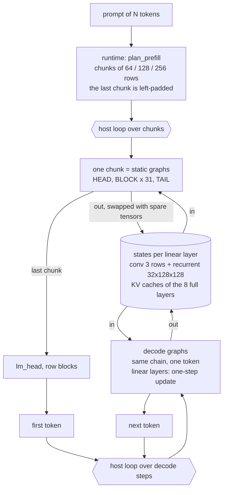
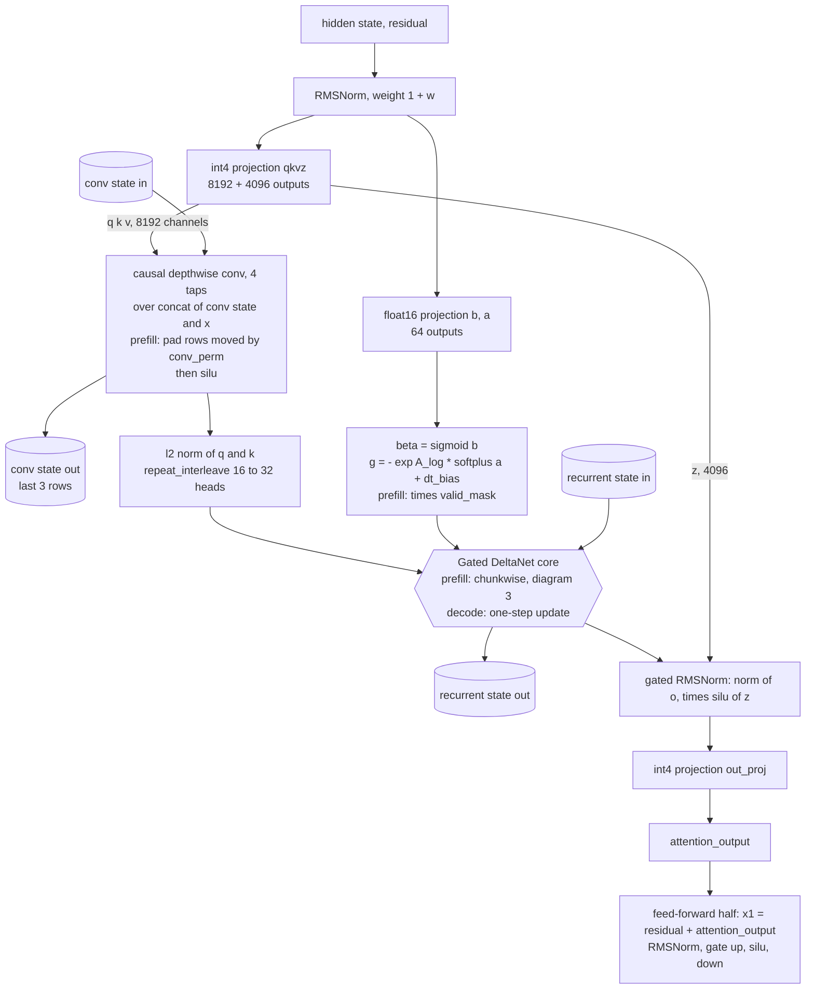
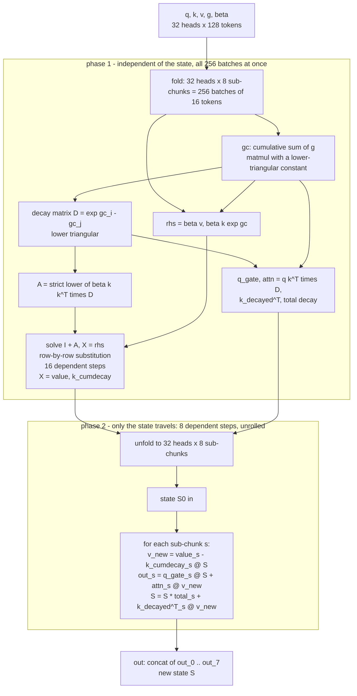

# Qwen3.5 (Qwen/Qwen3.5-4B): linear attention without a loop

Read from `config.json` and transformers' `modeling_qwen3_5.py` (5.3). The transformers model is the independent reference (`python/m2w/reference/qwen35_hf.py`, `python/tests/test_qwen35.py`, `m2w verify`).
Only the text decoder is compiled (the checkpoint also has a vision tower and an MTP head, ignored).

## The model

32 layers, hidden 2560, FFN 9216, vocabulary 248320 (tied embedding / lm_head), `layer_types` = 3 x `linear_attention` + 1 x `full_attention`, repeated (24 + 8 layers).

| | linear attention layer (Gated DeltaNet) | full attention layer |
|---|---|---|
| projections | `in_proj_qkv` 2560 -> 8192 (q 2048 | k 2048 | v 4096), `in_proj_z` -> 4096, `in_proj_b`, `in_proj_a` -> 32 each, `out_proj` 4096 -> 2560 | `q_proj` -> 16 x (256 query + 256 **gate**), `k_proj` / `v_proj` -> 4 x 256, `o_proj` |
| heads | 16 q / k heads of 128 repeated (`repeat_interleave`) to 32 value heads of 128 | 16 q heads, 4 KV heads, head dim 256, scale 1/16 |
| state | conv state [3, 8192] + recurrent state [32, 128, 128] per layer (no KV cache) | KV cache |
| norms | every RMSNorm is `x * rsqrt(mean(x^2) + eps) * (1 + w)`; the gated norm of the linear attention is `norm(o) * w` (plain) then `* silu(z)` | `q_norm` / `k_norm` with (1 + w) |
| positions | none | **partial rotary**: only the first 64 of 256 dims rotate (theta 1e7); `mrope` of text positions is the plain rotary |
| output | `out_proj(rmsnorm_gated(core(...), z))` | `o_proj(attention * sigmoid(gate))` |

Gated DeltaNet for one head (state S [dk, dv], per token: L2-normalised q, k, q scaled by dk^-0.5, `g = -exp(A_log) * softplus(a + dt_bias)` <= 0, `beta = sigmoid(b)`):

    S <- exp(g) S ;  S <- S + k (beta (v - S^T k))^T ;  o = S^T q          (the conv: depthwise causal, kernel 4, silu, over the 8192 qkv channels)

## Prefill without a loop or scan (WebNN has neither)

* **Across prefill chunks** the state is an input and an output of the graph, like a KV cache: the runtime's chunk loop is the loop.
* **Inside a chunk** the chunkwise-parallel form (flash-linear-attention, HF `torch_chunk_gated_delta_rule`) is a handful of matmuls per sub-chunk of 16 tokens; the sub-chunks of a prefill graph are
  unrolled (the trip count is static) and only the state travels from one to the next. The single non-matmul piece is `(I + A)^-1 [beta v | beta k exp(gc)]` for a strictly lower-triangular A,
  which HF computes with a for loop over the rows. It is a **row-by-row substitution** here (`gated_delta.forward_substitution`, 16 dependent steps for ALL sub-chunks at once: everything that
  does not depend on the state, i.e. the decay matrix, A, the substitution, `q k^T` and the decayed keys, is computed for all sub-chunks as a batch dimension; `gated_delta_batched`).
  The shortcut `(I - A)(I + A^2)(I + A^4)...` is exact in theory but **explodes for nearly parallel keys** (repeated text): the powers of A grow like binomial coefficients before they cancel; a blocked
  variant needs 8 x 8 activation matmuls, which the NPU compiler rejects.
* **Decode** is the one-token update (`gated_delta_step`): a few `[32,1,128] x [32,128,128]` matmuls.
* **Padding.** The last chunk is left-padded like everywhere else. A pad row is a no-op of the recurrence (`valid_mask` zeroes beta and g) and the conv state must skip the pad rows: `conv_perm`
  [C+3, C+3] is a permutation matrix applied to `[3 state rows | C chunk rows]` that moves the pad rows in front of the state rows (the identity for a full chunk); the new conv state is then the last 3 rows.
  `protocol.linear_prefill_controls` / `protocol.ts linearPrefillControls` build both. The states are zeroed at the start of every prompt.
* Accuracy (numpy interpreter against a float64 token loop, `python/tools/gdn_experiment.py`): float32 1e-7, float16 1e-3, also for nearly parallel keys and over twelve 128-token calls with the state
  kept in float16.

## How the chunkwise form is built (diagrams)

"Parallel" here is the algorithm, not a WebNN feature: a WebNN graph is a DAG of operators that the device runs in dependency order (the NPU is parallel *inside* an operator, e.g. a matmul).
The point is to replace 128 tiny dependent steps (one per token) by a few big batched matmuls plus a short dependent chain.

**Where the loops went**

    prompt of N tokens ---> runtime: chunks of 128 rows (the last one left-padded)             <- the chunk loop is the host loop, one dispatch chain per chunk
                              |  state (conv 3 rows, recurrent [32,128,128]) goes in and comes out of every linear layer, like a KV cache
                              v
                    one chunk = HEAD, BLOCK x 31, TAIL, (lm_head on the last chunk)  - static graphs
                              |
                              v   inside a linear attention half (graph):
        h --rmsnorm--> [qkvz projection] --> conv (4 taps + silu) --> q, k, v   [ba projection] --> beta, g
                                                                         |                            |
                                                                         +---- Gated DeltaNet core ---+---- state_in
                                                                                        |                       |
                                                                                        v                       v
                                                                      gated rmsnorm * silu(z) -> out_proj      state_out

**The core (`gated_delta_batched`), 128 tokens = 8 sub-chunks of 16, 32 heads**

    q, k, v, g, beta  [32 heads, 128 tokens]
        |  fold: [32 heads x 8 sub-chunks = 256 batches, 16 tokens]                 PHASE 1: no dependence on the state -> all 256 batches at once
        |    gc    = cumulative sum of g inside the sub-chunk          (matmul with a lower-triangular constant)
        |    D     = exp(gc_i - gc_j), lower triangular                 (decay matrix)
        |    A     = strict-lower( (beta k) k^T * D )
        |    [value | k_cumdecay] = (I + A)^-1 [beta v | beta k exp(gc)]   <- the only non-matmul piece: row-by-row substitution,
        |                                                                      16 dependent steps for all 256 batches together
        |    q_gate = q exp(gc);   attn = (q k^T) * D;   k_dec^T = (k exp(g_last - gc))^T;   total = exp(g_last)
        v
    unfold to [32 heads, 8 sub-chunks]                                          PHASE 2: only the state travels, 8 dependent steps
        for s in 0 .. 7:                     (unrolled, static)
            v_new = value_s - k_cumdecay_s @ S                  # what the state does not predict yet
            out_s = q_gate_s @ S + attn_s @ v_new               # contribution of the past + of the sub-chunk itself
            S     = S * total_s + k_dec_s^T @ v_new             # the new state
        out = concat(out_0 .. out_7) ;  state_out = S

Dependent chain per 128 tokens: 16 (substitution) + 8 x ~6 (phase 2) = about 60 steps of big batched operators, against 128 x ~8 tiny steps for the token recurrence
(`gated_delta_unrolled`, the OpenVINO-style loop body unrolled), measured 5.8 ms against 17.1 ms on the NPU. Decode (one token) is the plain one-step update (`gated_delta_step`).

### Flowcharts (Mermaid)

**1. From a prompt to logits: where the loops are**

**2. One linear attention layer (Gated DeltaNet) inside a BLOCK graph**

**3. The chunkwise core for one prefill chunk of 128 tokens (8 sub-chunks of 16, 32 heads)**

## What OpenVINO's own IR does, and where this package differs (OpenVINO/Qwen3.5-4B-int4-ov, `openvino_language_model.xml`)

The OV IR (made for the GPU) **does use control flow**: 24 `Loop` operators, one per Gated DeltaNet layer, and 64 `ReadValue` / `Assign` pairs (the stateful variables: 24 conv states, 24 recurrent states,
16 K / V caches of the 8 full attention layers); its shapes are dynamic (`ShapeOf`, `Range`, `Gather`). The Loop has a **dynamic trip count = the number of tokens** (prefill and decode use the same loop): every
iteration takes one token (q_t, k_t, v_t, g_t, beta_t sliced along the token axis, `part_size 1`), the state [B, 32, 128, 128] is loop-carried and the body is the recurrent update written with elementwise
operators and `ReduceSum` (no `MatMul`): `S * exp(g)`; `ReduceSum(S * k)`; `(v - that) * beta`; `S + k (x) delta` (`Unsqueeze` + `Multiply` + `Add`); `ReduceSum(S * q)` written into the output buffer with
`ScatterUpdate`. There is no chunkwise-parallel form in it (it is the torch fallback `torch_recurrent_gated_delta_rule` traced as it is). That is fine for a GPU plugin that runs a Loop; WebNN has no
loop operator, and a per-token dispatch of the decode graph would make a prompt of N tokens cost N decode steps.

| | OpenVINO IR (GPU) | this package (WebNN, static) |
|---|---|---|
| recurrence over the prompt | `Loop`, one iteration per token, dynamic trip count | none: chunk loop in the runtime (state in / out like a KV cache), inside a chunk the chunkwise-parallel form with the sub-chunks unrolled and the triangular solve as a 16-step substitution |
| decode | the same Loop with one iteration | `gated_delta_step`: a few matmuls |
| conv | `GroupConvolution` over `concat(conv_state, x)`, kernel quantized | 4 shifted multiply-adds over `concat(conv_state, x)`, kernel float16 |
| state | `ReadValue` / `Assign` | graph inputs / outputs, swapped with a spare tensor by the runtime |
| same in both | RMSNorm `pow, mean, add, sqrt, divide, mul` with `(1 + w)` folded, gated norm `norm(o) * w * silu(z)`, `SoftPlus`, `Swish`, key / query heads repeated with `repeat_interleave`, int4 projections |
| l2norm | `ReduceSum`, `Add`, `Sqrt`, `Divide` | the RMS-norm pattern (the NPU compiler returned garbage for the key with the sum form) |
| quantization | int4 **asymmetric**, group 128, also the conv kernel and in_proj_a / in_proj_b | int4 symmetric group 128, conv kernel / in_proj_a / in_proj_b float16 |

So the pointwise parts, the projections and the norms follow the OV graph; the recurrence and the conv do not, on purpose.

## What the NPU compiler did (LNL, `bench/raw/gdn.html`, see also docs/npu-local)

* f32 graphs run as f16 (identical results); everything is judged in f16.
* An activation x activation matmul with dims 4 / 8 fails with *"Failed to create session"*: every dim of such a matmul is >= 16 here (sub-chunk 16).
* A multiplication result that feeds a matmul AND an add returns **wrong results without an error** (`state * exp(g)` in the decode step). The step scales the prediction instead
  (`gated_delta_step`); on GPU f16 even that variant was wrong in one test, so every new graph shape has to be compared with the interpreter ON THE DEVICE: `bench/raw/qwen35check.html`.
* Core of one layer, 128 tokens, 32 heads: ~5 ms (sub-chunk 16; 32: 5.5 ms; 64: 10 ms); decode step 0.6 ms.

## How the package differs from the other families

* `m2w compile` family `qwen3.5` (`families/qwen35.json`), builder `qwen35`: `builders/qwen35.py`, `pack_qwen35.py`, plan `architecture_kind: "qwen35"`, runtime `Qwen35LLM` (`src/runtime/llm-qwen35.ts`),
  numpy `reference/qwen35_runner.py`. Staged KV only (for the 8 full attention layers), no block groups yet.
* Two BLOCK graphs (kinds `linear_attention` and `full_attention`): BLOCK i = feed-forward half of layer i + attention half of layer i + 1 of its kind. The attention half **includes the output
  projection** (the interface between the halves is `attention_output` [1,S,hidden]).
* Packing (`pack_qwen35.py`): every RMSNorm weight is stored as `1 + w`; `q_proj` is split into query rows and gate rows and joined with k and v into one int4 projection
  `qkvg_projection`; the head dims of the query / key rows and of `q_norm` / `k_norm` are **permuted** so that the rotating pairs (i, i + 32) sit at (i, i + 128): the graph rotates the whole head
  dim with frequencies that are 0 for the dims that do not rotate (`rope.partial_inv_freq`); scores do not depend on a consistent permutation. `in_proj_qkv` + `in_proj_z` are one int4 projection,
  `in_proj_b` / `in_proj_a` stay float16 (64 rows), the conv kernel is stored `[4, 1, 8192]`, `decay_rate = exp(A_log)`.
* Graph inputs of a linear attention half: `conv_state` [1,3,8192], `recurrent_state` [1,32,128,128] (float16, outputs `new_conv_state` / `new_recurrent_state`, swapped with their spares by the
  runtime), prefill only `valid_mask` [1,1,S,1] and `conv_perm` [1,S+3,S+3]. The chunk sizes of a package must be multiples of 16.
* Ops beyond the Qwen3 set: `exp`, `softplus` (and `reduceSum`, `sigmoid`).

## Verification

* `python/tests/test_qwen35.py`: a tiny hybrid model built with transformers; logits of multi-chunk prefills (left-padded last chunk) and 10 decode steps (staging flushes) equal the transformers
  model fed with the package's dequantized weights to float16 noise.
* `m2w verify <package> --source <hf dir>`: the same on the real model (the transformers reference is slow on the CPU: use a short prompt).
* `bench/raw/qwen35check.html` (trace written by `python/tools/qwen35_trace.py`): the hidden state entering every layer on the device against the numpy interpreter's, in the last prefill chunk and the first decode step.
